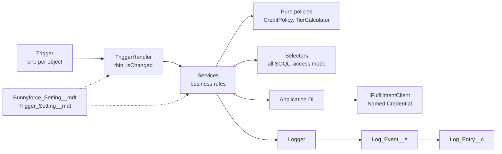

# Bunnyforce Supply Co. — Salesforce Org

Source for the Salesforce org behind **Bunnyforce Supply Co.**, a B2B wholesale distributor of
small-animal supplies (hay, pellets, bedding, habitats) selling to independent pet retailers.

The org runs on Sales Cloud (Account, Order, Product2) with custom Apex for tier pricing, credit
control and 3PL fulfillment. Changes ship through Gearset pipelines and are reviewed by
[CodeRabbit](https://coderabbit.ai) against the team checklist in
[docs/apex-standards.md](docs/apex-standards.md).

## Business capabilities

| Capability | How it works | Key classes |
| --- | --- | --- |
| **Tier pricing** | Order lines get the best active `Pricing_Rule__c` discount for the account's tier, product family and quantity. | `PricingService`, `PricingRulesSelector`, `OrderItemTriggerHandler` |
| **Credit control** | Activating an order runs a credit check. An order that would push the account past its credit limit (plus a configurable grace) goes **On Hold**. `Open_Order_Value__c` and `Credit_Hold__c` stay in sync automatically. | `CreditCheckService`, `CreditPolicy`, `OrderTriggerHandler`, `AccountTriggerHandler` |
| **3PL fulfillment** | Credit-approved orders are submitted to the fulfillment provider asynchronously, in chunks that stay within the callout limit. Perishables route to a cold-chain warehouse. | `OrderFulfillmentQueueable`, `OrderFulfillmentService`, `FulfillmentClient` |
| **Status webhooks** | The provider posts shipment and delivery updates to an Apex REST endpoint. | `OrderStatusWebhook` |
| **Customer tiering** | A nightly batch recalculates trailing 12-month revenue and promotes or demotes tiers. | `CustomerTierRecalcBatch`, `CustomerTierCalculator` |
| **Credit summary UI** | A Lightning web component on the Account page shows tier, limit, utilization and hold status. | `accountCreditSummary`, `AccountCreditController` |

## Architecture



| Layer | Convention |
| --- | --- |
| Triggers | One per object, single line: `new XTriggerHandler().run();` |
| `TriggerHandler` | Base class with context dispatch, `bypass()`, `isChanged()`, and a per-object kill switch via `Trigger_Setting__mdt`. |
| Services | Bulk-safe business logic. Use interfaces for external collaborators. |
| Selectors | The only place SOQL lives. `USER_MODE` by default; `SYSTEM_MODE` only for automation, with a comment explaining why. |
| `Application` | Minimal DI registry so tests can inject fakes (`Application.setMock`). |
| `Logger` | Buffers entries and publishes them as `Log_Event__e`, so they survive rollback; persisted as `Log_Entry__c`. |
| `BunnyforceSettings` | Typed access to `Bunnyforce_Setting__mdt`. Nothing is hardcoded. |
| `TestDataFactory` | The single source of test data. |

## Repository layout

```
force-app/main/default/
  classes/          Apex classes and tests
  triggers/         One trigger per object
  objects/          Custom objects, fields, platform event, custom metadata types
  customMetadata/   Trigger switches and application settings
  permissionsets/   Bunnyforce_Sales_Ops, Bunnyforce_Fulfillment_Integration
  lwc/              accountCreditSummary
config/pmd/         PMD ruleset (used by CodeRabbit and CI)
docs/               Code review standards (CodeRabbit knowledge base)
.coderabbit.yaml    CodeRabbit review configuration
```

## Org setup

Prerequisites: [Salesforce CLI](https://developer.salesforce.com/tools/salesforcecli), Node 20+, Java 17+ (for PMD).

1. **Enable Orders.** Setup → Order Settings → *Enable Orders*. Developer Edition orgs usually have this on already.
2. **Deploy.**

   ```bash
   sf org login web --alias bunnyforce
   sf project deploy start --target-org bunnyforce --test-level RunLocalTests
   ```

3. **Create the fulfillment named credential.** This is environment-specific, so it is not in source control.
   - Setup → Named Credentials → External Credentials → **New**: `Fulfillment_API_Auth` (Custom auth protocol, with an `Authorization` header parameter holding the provider API key).
   - Named Credentials → **New**: label `Fulfillment API`, name `Fulfillment_API`, URL = provider base URL (a sandbox or mock such as `https://httpbin.org/anything` works for a demo), linked to the external credential.
   - Grant the external credential principal to the permission set held by users who activate orders. The fulfillment Queueable runs as the enqueuing user.
4. **Assign permission sets.**

   ```bash
   sf org assign permset --name Bunnyforce_Sales_Ops --target-org bunnyforce
   ```

5. **Schedule the nightly tier job.** Run this as anonymous Apex:

   ```apex
   CustomerTierRecalcBatch.scheduleNightly();
   ```

6. Add the **Account Credit Summary** component to the Account record page in Lightning App Builder.

## Development

```bash
npm install
npm run prettier          # format Apex, LWC, XML
npm run lint              # ESLint for LWC
npm run scan              # PMD with the team ruleset (requires pmd on PATH)
npm run test:apex         # run local Apex tests against the default org
```

See [CONTRIBUTING.md](CONTRIBUTING.md) for branching and review flow.

## Code review with CodeRabbit

[`.coderabbit.yaml`](.coderabbit.yaml) tunes CodeRabbit to the team checklist:

- **Path instructions** for each architectural layer: triggers, handlers, services, selectors, async Apex, controllers, integrations, tests, LWC, metadata and permission sets.
- **Pre-merge checks.** Seven *blocking* checks: no SOQL/DML in loops, no hardcoded IDs or endpoints, explicit sharing, CRUD/FLS and injection-safe SOQL, one trigger per object, meaningful test assertions, and no callouts from trigger context. Ten more checks are *advisory*: test coverage, Logger usage, method size, naming, configuration, DI, order of execution, large data volume, declarative-first, and deployment completeness.
- **PMD** runs with [`config/pmd/apex-ruleset.xml`](config/pmd/apex-ruleset.xml). Gitleaks and TruffleHog run for secrets.
- **Knowledge base**: `docs/apex-standards.md` is loaded as code guidelines, so review comments cite rule IDs such as `BF-PERF-1`.
- **GitHub checks**: CodeRabbit reads Gearset validation and CI results when they fail.

## Deployment (Gearset)

Pull requests are validated by Gearset (a deployment check plus `RunLocalTests`) before merge, and merged
changes are promoted through the Gearset pipeline. Environment-specific configuration (named
credentials, integration users) is managed per environment in the org, not in source.
